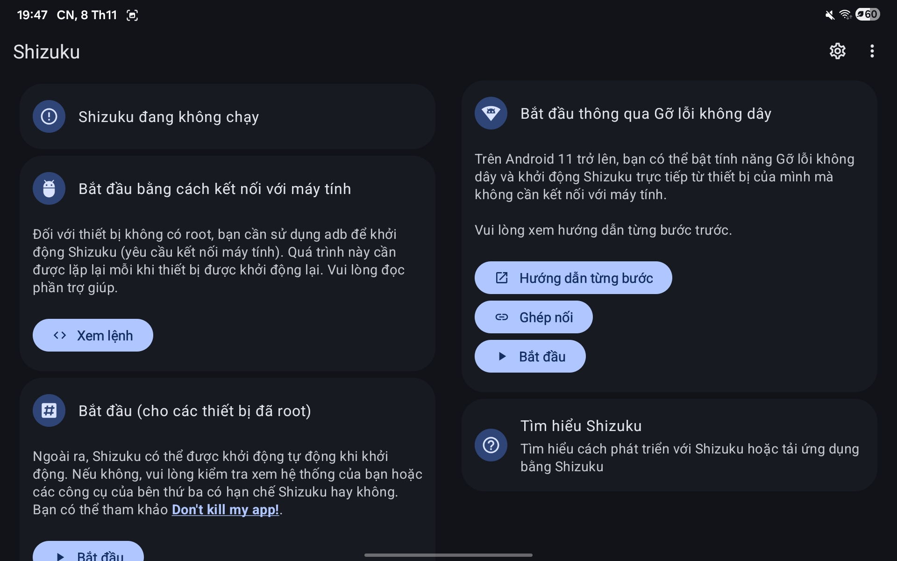
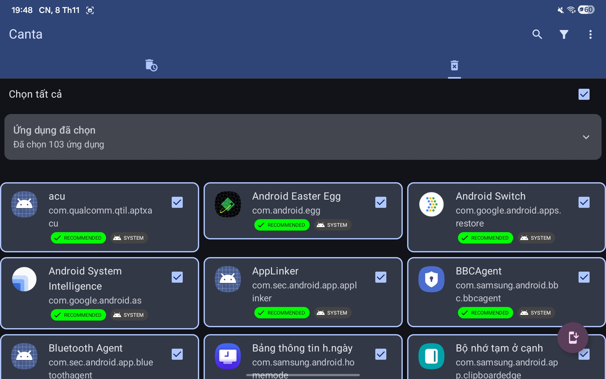
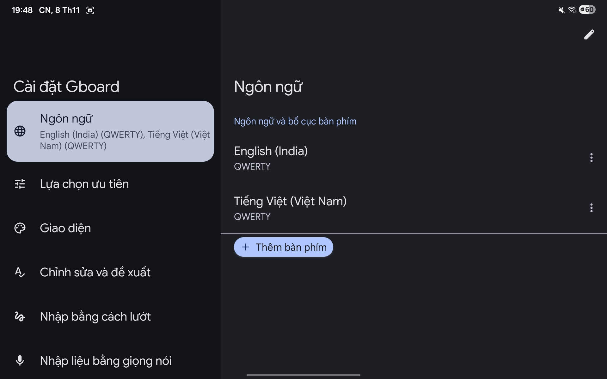

# Hướng dẫn tối ưu smartphone & tablet Samsung

Bộ thiết lập giúp máy Samsung (One UI) **mượt hơn, tiết kiệm pin hơn, ít bị làm phiền hơn và riêng tư hơn**. Mỗi bước đều có ảnh minh họa, phần được khoanh đỏ là chỗ cần chạm hoặc gạt.

> Ảnh chụp trên máy tính bảng Galaxy Tab (màn hình chia hai cột). Trên điện thoại, đường dẫn menu giống nhau nhưng giao diện là một cột. Tên mục có thể lệch đôi chút tùy đời máy và phiên bản One UI.

---

## Mục lục

1. [Thông báo](#1-thông-báo)
2. [Màn hình](#2-màn-hình)
3. [Pin: giới hạn ứng dụng chạy dưới nền](#3-pin-giới-hạn-ứng-dụng-chạy-dưới-nền)
4. [Màn hình khóa: Now bar](#4-màn-hình-khóa-now-bar)
5. [Bảo mật và quyền riêng tư](#5-bảo-mật-và-quyền-riêng-tư)
6. [Dịch vụ Google](#6-dịch-vụ-google)
7. [Chăm sóc thiết bị](#7-chăm-sóc-thiết-bị)
8. [Gỡ ứng dụng thừa](#8-gỡ-ứng-dụng-thừa)
9. [Bàn phím](#9-bàn-phím)
10. [Hỗ trợ: giảm hiệu ứng](#10-hỗ-trợ-giảm-hiệu-ứng)
11. [Âm thanh hệ thống](#11-âm-thanh-hệ-thống)
12. [Bảo trì định kỳ](#12-bảo-trì-định-kỳ)
13. [Checklist tổng hợp](#13-checklist-tổng-hợp)

---

## 1. Thông báo

### 1.1. Tắt gợi ý hành động và trả lời cho thông báo

Tính năng này luôn phân tích nội dung thông báo để đưa ra gợi ý. Tắt đi sẽ đỡ tốn tài nguyên và đỡ rối.

**Đường dẫn:** Cài đặt → **Thông báo** → **Sắp xếp và lọc thông báo** (trang *Cài đặt nâng cao*)

Trong trang *Cài đặt nâng cao*, **tắt** hai mục được khoanh đỏ:

- Gợi ý hành động và trả lời cho thông báo
- Hiển thị phím tạm dừng

### 1.2. Tắt thông báo của ứng dụng quảng cáo hoặc không cần thiết

Nhiều ứng dụng (game, Google, YouTube...) liên tục đẩy thông báo gợi ý và quảng cáo. Chỉ để lại thông báo của những ứng dụng bạn cần, như tin nhắn, lịch, email.

**Đường dẫn:** Cài đặt → **Thông báo** → **Thông báo ứng dụng**, rồi gạt tắt từng ứng dụng.

Ví dụ tắt **Google** và **Liên Quân Mobile**:

Ví dụ tắt **YouTube** và **YouTube Music**:

---

## 2. Màn hình

### 2.1. Bật Dark mode

Với màn hình **AMOLED**, các điểm ảnh đen được tắt hẳn nên Dark mode giúp tiết kiệm pin rõ rệt. Màn hình LCD không tiết kiệm được nhiều.

**Cách bật nhanh:** vuốt từ cạnh trên màn hình để mở bảng điều khiển nhanh, rồi chạm biểu tượng **mặt trăng** (khoanh đỏ).

### 2.2. Đưa độ mượt chuyển động về mức Tiêu chuẩn

**Đường dẫn:** Cài đặt → **Màn hình** → **Độ mượt chuyển động** → chọn **Tiêu chuẩn**.

Tần số quét cao (120 Hz) cho cảm giác mượt hơn nhưng tốn pin hơn. Mức Tiêu chuẩn (60 Hz) cân bằng tốt hơn cho dùng hằng ngày.

### 2.3. Bật Độ nhạy cảm ứng

**Đường dẫn:** Cài đặt → **Màn hình** → kéo xuống → bật **Độ nhạy cảm ứng**.

Mục này giúp màn hình nhận thao tác chạm tốt hơn, nhất là khi dán **miếng dán bảo vệ màn hình**.

---

## 3. Pin: giới hạn ứng dụng chạy dưới nền

Cho các ứng dụng hay chạy ngầm vào danh sách **Ứng dụng đang nghỉ**. Ứng dụng trong danh sách này chỉ thỉnh thoảng mới được chạy nền, nên tiết kiệm pin và RAM. Bạn không cần lo thông báo bị chậm.

**Bước 1:** Cài đặt → **Pin** → **Giới hạn sử dụng dưới nền**.

**Bước 2:** Chạm vào **Ứng dụng đang nghỉ**.

**Bước 3:** Chạm dấu **+** ở góc trên bên phải, rồi chọn các ứng dụng muốn thêm. Có thể chọn hết.

> **Lưu ý:** Ứng dụng nhắn tin hoặc xác thực bạn cần nhận thông báo tức thì thì có thể để ngoài danh sách. Nếu thấy thông báo của ứng dụng nào đến trễ, hãy gỡ nó khỏi danh sách.

---

## 4. Màn hình khóa: Now bar

Now bar hiển thị thông tin trực tiếp ngay trên màn hình khóa. Tắt những nguồn bạn không dùng, ví dụ Google Finance, để bớt tác vụ nền.

**Đường dẫn:** Cài đặt → **Màn hình khóa** → **Now bar**.

Trong mục *Thông báo trực tiếp*, **tắt Google Finance**.

---

## 5. Bảo mật và quyền riêng tư

**Đường dẫn:** Cài đặt → **Bảo mật và riêng tư**.

### 5.1. Kiểm tra quyền của ứng dụng

Trong mục *Riêng tư*, xem **Các quyền được sử dụng trong 24 giờ qua** để biết ứng dụng nào vừa dùng **máy ảnh, micro, vị trí**. Sau đó vào **Trình quản lý quyền** và thu hồi quyền của ứng dụng dùng quá nhiều hoặc không cần.

Cuối mục này có **Cài đặt quyền riêng tư khác**, nơi bạn sẽ tắt các dịch vụ thu thập dữ liệu ở bước 5.2.

### 5.2. Tắt gửi dữ liệu chẩn đoán và cá nhân hóa

Vào **Cài đặt quyền riêng tư khác** và **tắt**:

- **Gửi dữ liệu chẩn đoán** (Samsung)
- **Dịch vụ cá nhân hóa Android** (Google)

Tiếp theo, cuộn xuống chạm **Dữ liệu sử dụng và chẩn đoán** (Google) và **tắt** công tắc trong trang đó.

---

## 6. Dịch vụ Google

**Đường dẫn:** Cài đặt → **Google** (Dịch vụ Google) → **Tất cả dịch vụ** → mục *Quyền riêng tư và bảo mật*.

Chạm vào từng mục được khoanh đỏ và **tắt**:

- **Cá nhân hóa bằng dữ liệu được chia sẻ**
- **Dữ liệu sử dụng và chẩn đoán** (đã làm ở bước 5.2, kiểm tra lại cho chắc)

---

## 7. Chăm sóc thiết bị

**Đường dẫn:** Cài đặt → **Chăm sóc thiết bị**.

### 7.1. Bật tự động khởi động lại

Máy khởi động lại định kỳ sẽ giải phóng RAM và hạn chế giật lag sau thời gian dài không tắt máy.

Trong *Chăm sóc thiết bị*, kéo xuống mục *Hiệu suất* và chạm **Tự động tối ưu**.

Ở cuối trang, chạm **Tự khởi động lại** và bật lên. Ảnh dưới là lịch khởi động lại lúc **03:00 mỗi ngày**. Nên chọn giờ bạn không dùng máy.

### 7.2. Tắt RAM Plus

RAM Plus dùng một phần bộ nhớ trong làm RAM ảo. Tính năng này thường không cải thiện được bao nhiêu mà còn hao bộ nhớ lưu trữ.

Trong *Chăm sóc thiết bị*, chạm vào mục **Bộ nhớ**.

Kéo xuống cuối trang, chạm **RAM Plus** và chọn **Tắt**.

> Cũng trong trang *Bộ nhớ* có nút **Dọn ngay** để dừng các ứng dụng chạy nền và giải phóng RAM tức thì khi máy đang chậm.

---

## 8. Gỡ ứng dụng thừa

Máy Samsung cài sẵn nhiều ứng dụng không dùng đến, chạy nền và ngốn tài nguyên.

### 8.1. Cách thông thường

**Đường dẫn:** Cài đặt → **Ứng dụng**, rồi **tắt** hoặc **gỡ cài đặt** ứng dụng cài sẵn không cần thiết. Một vài ứng dụng hệ thống cũng gỡ được.

### 8.2. Cách nâng cao: Shizuku + Canta

Dùng khi muốn gỡ cả ứng dụng hệ thống mà menu thông thường không cho gỡ. Cần cài 2 ứng dụng: **Shizuku** (cấp quyền ADB cho ứng dụng khác) và **Canta** (gỡ ứng dụng hàng loạt).

**Bước 1: Khởi động Shizuku bằng Gỡ lỗi không dây** (Android 11 trở lên, không cần máy tính).

1. Bật **Tùy chọn nhà phát triển** (Cài đặt → Thông tin điện thoại → Thông tin phần mềm → chạm *Số bản dựng* 7 lần).
2. Bật **Gỡ lỗi không dây** trong Tùy chọn nhà phát triển.
3. Mở Shizuku, ở khung *Bắt đầu thông qua Gỡ lỗi không dây*, làm theo **Ghép nối** rồi **Bắt đầu**. Xem **Hướng dẫn từng bước** trong ứng dụng nếu cần.

> Với máy không root, **mỗi lần khởi động lại máy phải bật Shizuku lại** (như dòng giải thích trong ảnh). Nếu bạn dùng chức năng tự khởi động lại ở mục 7, hãy nhớ điều này.

**Bước 2: Mở Canta và chọn ứng dụng cần gỡ.** Canta gắn nhãn **RECOMMENDED** cho các ứng dụng nên gỡ. Hãy gỡ theo danh sách này.

> **Cẩn thận:** Nút *Chọn tất cả* sẽ chọn toàn bộ danh sách (ảnh trên là 103 ứng dụng). Hãy **kéo xuống đọc lại danh sách** trước khi gỡ và bỏ chọn những ứng dụng bạn vẫn dùng. Ví dụ trong ảnh có *Bảng thông tin h.ngày* và *Bộ nhớ tạm ở cạnh*, là những tính năng có thể bạn đang dùng. Tránh gỡ những thứ bạn không rõ chức năng. Canta có tab khôi phục (biểu tượng thùng rác có đồng hồ) nếu gỡ nhầm.

---

## 9. Bàn phím

Bàn phím có tính năng đoán chữ, sửa lỗi, đề xuất emoji, phát âm thanh khi gõ. Tắt các tính năng này giúp gõ nhanh và nhẹ máy hơn.

### 9.1. Dùng bàn phím ngoài như Gboard

**Đường dẫn:** Cài đặt → **Quản lý chung** → **Bàn phím**.

Chọn **Bàn phím mặc định** → **Gboard**. Cả Gboard và Bàn phím Samsung đều xuất hiện trong danh sách *Tất cả*, chạm vào tên bàn phím để vào phần cài đặt của nó.

### 9.2. Nếu dùng Gboard

Mở **Cài đặt Gboard** (có ngay trong Quản lý chung hoặc chạm biểu tượng bánh răng trên bàn phím).

**Lựa chọn ưu tiên** → mục *Gõ phím*, **tắt**:

- **Âm thanh** (phát khi nhấn phím)
- **Cửa sổ bật lên của phím** (xem trước ký tự)

**Chỉnh sửa và đề xuất** → mục *Tự động sửa lỗi*, **tắt**:

- **Tự động sửa**
- **Tự động viết hoa**

### 9.3. Nếu dùng Bàn phím Samsung

Vào **Bàn phím Samsung** (xem ảnh ở 9.1), mục *Nhập thông minh*, **tắt**:

- **Tiên đoán văn bản**
- **Tự động thay thế**
- **Tự động kiểm tra chính tả**
- **Đề xuất emoji**

Đồng thời tắt âm thanh bàn phím ở [mục 11](#11-âm-thanh-hệ-thống).

---

## 10. Hỗ trợ: giảm hiệu ứng

Giảm hiệu ứng chuyển động và làm mờ giúp giao diện phản hồi nhanh hơn và đỡ tốn GPU.

**Đường dẫn:** Cài đặt → **Hỗ trợ** → **Cải thiện thị giác**.

Kéo xuống và **bật**:

- **Giảm ảnh động**
- **Giảm độ trong suốt và độ mờ**

---

## 11. Âm thanh hệ thống

**Đường dẫn:** Cài đặt → **Âm thanh** → **Âm thanh hệ thống**.

**Tắt** các âm sau:

- **Tương tác chạm**
- **Bàn phím Samsung**
- **Sạc pin**
- **Khóa/mở khóa màn hình**

---

## 12. Bảo trì định kỳ

### 12.1. Xóa bộ nhớ đệm (cache) của ứng dụng

Bộ nhớ đệm phình to theo thời gian làm đầy bộ nhớ và có thể làm ứng dụng chậm. Xóa cache **không làm mất dữ liệu hay tài khoản**. Nên làm thường xuyên.

**Bước 1:** Cài đặt → **Ứng dụng**. Danh sách có thể sắp xếp theo dung lượng. Chọn trước những ứng dụng chiếm nhiều dung lượng (khoanh đỏ trong ảnh), như game, trình duyệt, mạng xã hội.

**Bước 2:** Trong *Thông tin ứng dụng*, chạm **Lưu trữ**.

**Bước 3:** Chạm **Xóa bộ nhớ đệm** (góc dưới bên phải).

> **Đừng chạm nhầm Xóa dữ liệu** (nút bên cạnh). Nút đó xóa toàn bộ dữ liệu ứng dụng, gồm đăng nhập và tiến trình game.

### 12.2. Rà soát định kỳ

- Cứ vài tuần, xem lại **Pin** để biết ứng dụng nào đang tốn pin nhất, và xem lại **Trình quản lý quyền** (mục 5.1).

---

## 13. Checklist tổng hợp

| # | Mục | Việc cần làm |
|---|-----|--------------|
| 1 | Thông báo | Tắt *Gợi ý hành động và trả lời* và *Hiển thị phím tạm dừng*; tắt thông báo ứng dụng không cần |
| 2 | Màn hình | Bật Dark mode (máy AMOLED); độ mượt chuyển động = Tiêu chuẩn; bật Độ nhạy cảm ứng |
| 3 | Pin | Thêm ứng dụng hay chạy ngầm vào *Ứng dụng đang nghỉ* |
| 4 | Màn hình khóa | Now bar: tắt Google Finance |
| 5 | Quyền riêng tư | Tắt *Gửi dữ liệu chẩn đoán*, *Dịch vụ cá nhân hóa Android*, *Dữ liệu sử dụng và chẩn đoán*; rà soát quyền camera, vị trí, micro |
| 6 | Dịch vụ Google | Tắt cá nhân hóa bằng dữ liệu được chia sẻ; tắt dữ liệu sử dụng và chẩn đoán |
| 7 | Chăm sóc thiết bị | Bật tự động khởi động lại; tắt RAM Plus |
| 8 | Ứng dụng | Gỡ ứng dụng cài sẵn không cần (có thể dùng Shizuku + Canta, chỉ gỡ mục RECOMMENDED) |
| 9 | Bàn phím | Dùng Gboard; tắt âm thanh, xem trước ký tự, tiên đoán từ, sửa chính tả, đề xuất emoji |
| 10 | Hỗ trợ | Bật *Giảm ảnh động* và *Giảm độ trong suốt và độ mờ* |
| 11 | Âm thanh hệ thống | Tắt âm chạm, bàn phím, sạc pin, khóa/mở khóa |
| 12 | Bảo trì | Xóa cache ứng dụng định kỳ |
